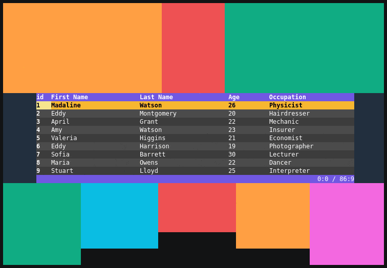
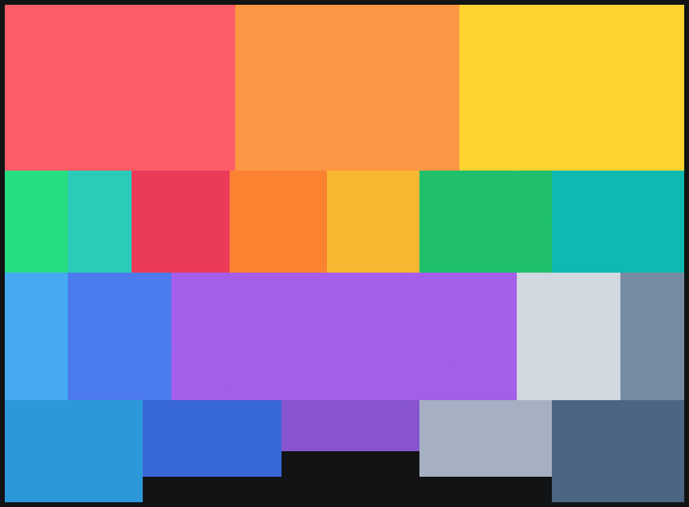
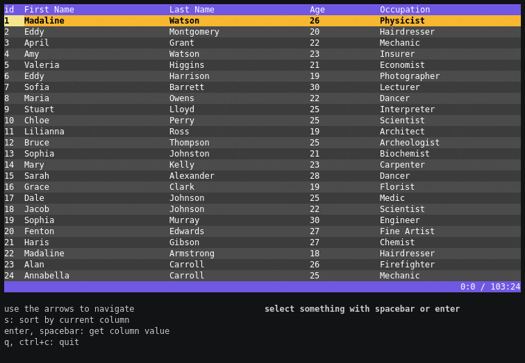

# Stickers 👾
It is a collection of TUI elements—FlexBox and Table—built for [Bubble Tea v2](https://github.com/charmbracelet/bubbletea) using [Lip Gloss v2](https://github.com/charmbracelet/lipgloss).

## Flex Box 📦
Responsive grid box insipred by CSS flexbox. 
Easy to create responsive grids that scale using ratios between these elements.

## Table 🍰
Responsive, x/y scrollable, sortable table using FlexBox. 
Tabel viewer with ability to get the content of the cell over which the cursor is placed at and sort the data by column. Sorting supports basic number and string type so number sorting is possible 🎉

##### TODO
- filtering ✅
- sorting ✅

## Known issues
~~Table selected cell is not rendering background color correctly, will be fixed with https://github.com/charmbracelet/lipgloss/pull/69~~ 

***
Made with [Charm](https://charm.sh).

